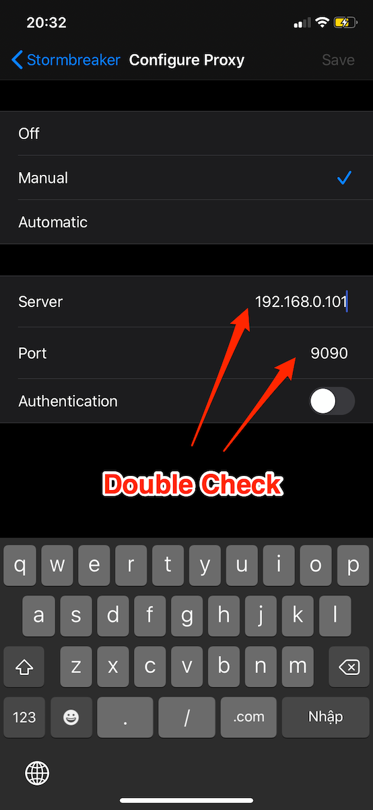
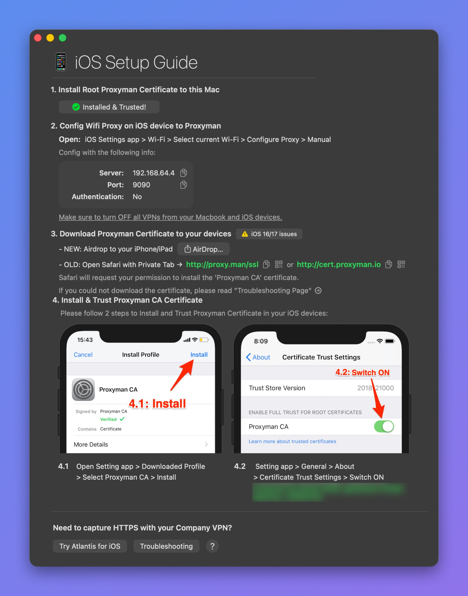

# My Remote Devices (iOS/Android) could not connect to Proxyman?

## **1.** Problems

* ❌ My iOS or Android device can't access the internet after I change the proxy setting in the Wi-Fi settings.
* ❌ I can't download the certificate from **http://cert.proxyman.io** or **http://proxy.man/ssl**


For Android, follow the [Android Devices and Android Emulators](my-ios-devices-couldnt-connect-to-proxyman-via-proxy.md#android-devices-and-android-emulators) section.


## 2. Solution: iOS devices

Double-check the following steps:

### 0. Issue with iOS 16 Physical Devices / Simulator

Some users report that **Proxyman** and **Charles Proxy** could not capture any traffic from iOS 16 devices or simulators, even though the HTTP proxy is set.

It's an iOS bug. If you see it on iOS 17, iOS 18 or iOS 26, use the same fix.

Workarounds:

#### iOS physical devices

* Forget the Wi-Fi network, connect again, and set the HTTP proxy again.
* Use the [Atlantis framework](https://github.com/ProxymanApp/atlantis) to capture the traffic.

#### iOS Simulator

* Follow the [iOS Simulator setup guide](../debug-devices/ios-simulator.md).
* Use the [Atlantis framework](https://github.com/ProxymanApp/atlantis) to capture the traffic.


[ios-16-devices-issues.md](ios-16-devices-issues.md)


### 1. Make sure your Mac device and iOS/Android devices are on the same network

If they're on different networks, they can't connect to each other.

### 2. Make sure the server IP and port match Proxyman

<figure><figcaption><p>Proxy settings on the iPhone</p></figcaption></figure>

<figure><figcaption><p>Server IP and port in the iOS Setup Guide</p></figcaption></figure>

### 3. Turn OFF all VPN apps on macOS and iOS/Android devices

By default, a VPN app **forces** all traffic through the VPN server instead of the Proxyman proxy server (port 9090). Therefore, no requests appear in Proxyman.

Turning OFF all VPN apps will fix it:

* For **iOS** devices: Open Settings -> General -> VPN & Device Management -> VPN and make sure the VPN status is **Not Connected**.
* For **Android** devices: Find the VPN setting in the Settings app and turn it OFF.
* For **macOS**: Quit all VPN apps.

If you can't turn off your VPN, see [Proxyman does not work with VPN apps](proxyman-does-not-work-with-vpn-apps.md).

### 4. Firewall settings (macOS)

The macOS firewall might block incoming connections to your Mac. Then your remote devices can't connect to Proxyman.

On **macOS**: Open **System Settings -> Network -> Firewall -> Options…**

**Verify that:**

* Block all incoming connections is **OFF**
* The Proxyman app is set to **Allow incoming connections**
* If Proxyman is not in the list, add it with the **+** button
* Automatically allow built-in software to receive incoming connections is **ON**
* Automatically allow downloaded signed software to receive incoming connections is **ON**

### 5. Firewall settings (Windows 10/11)

Windows 10/11 might block Proxyman, so iPhone and Android devices can't connect to the app. To fix it:

1. Search for and open the "Windows Defender Firewall" app, then click "Advanced settings" on the left panel.
2. Select "Inbound Rules".
3. Find proxyman.exe and double-click it to open its settings.
4. Select "Allow the connection" in the General tab.
5. Click OK.

<figure><figcaption><p>Allow Proxyman in Windows Firewall</p></figcaption></figure>

### 6. If you're on a company network, ask the Security team to open Proxyman's port 9090

Some companies block certain ports by default. Then your iOS devices can't reach Proxyman on port 9090.

### 7. Use a Private tab in Safari to open http://cert.proxyman.io or http://proxy.man/ssl

### 8. I'm still unable to connect

If you followed all the steps above and the configuration is correct, but it still doesn't work:

Try to **turn Wi-Fi off and on, forget the Wi-Fi network (iOS),** and **restart your computer**.

### 9. Still doesn't work? (iOS app only)

Setting the HTTP proxy by hand and installing and trusting the Proxyman certificate on iOS devices is hard. We understand that. Try Atlantis, an iOS framework that does it for you.


[atlantis-for-ios.md](../atlantis/atlantis-for-ios.md)


## Android Devices and Android Emulators

### 1. After setting the HTTP proxy in the Wi-Fi settings, I can't open http://proxy.man/ssl

* [Follow the troubleshooting steps above](my-ios-devices-couldnt-connect-to-proxyman-via-proxy.md#1.-make-sure-your-mac-device-and-ios-android-devices-are-on-the-same-network) ☝️&#x20;
* Double-check the Wi-Fi connection in the emulator. It must show Connected (not Limited Connection or No Internet).

If it doesn't, **forget the network** and **reconnect to the Wi-Fi.**

### 2. Install and trust the Proxyman CA on Android API 30+

From Android Emulator API 30+, you need extra steps to trust the Proxyman certificate:

* Open http://proxy.man/ssl in Google Chrome to download the certificate.
* Open the Settings app -> Security -> Encryption & Credentials -> Install a certificate -> CA certificate -> Install anyway, and select the Proxyman CA certificate in your storage.

You can verify it in Trusted credentials -> User tab.

### 3. My Android physical device or emulator connection is not stable

It's probably caused by the Android device or emulator. A possible fix is to change the DNS on your Mac or Android device to **8.8.8.8**.

* **On macOS**: Open System Settings -> Network -> Wi-Fi -> Details… -> DNS, then add **8.8.8.8** to the DNS Servers list.
* **On an Android device**: Open the Wi-Fi settings and set the DNS to **8.8.8.8**.

Read more in [GitHub issue #636](https://github.com/ProxymanApp/Proxyman/issues/636).

### 4. The `adb` command is not found when using the Android Emulator automatic script

If you try to override the Android Emulator and get the following error:

```
adb command line could not be found!!!
```

Install the `adb` command line tool, then try again.

* [How to install ADB](../debug-devices/android-device/automatic-script-for-android-emulator.md#3.-how-to-use-it)

### 5. Not sure how to install and trust the Proxyman certificate on an Android Emulator? Use the [Automatic Script for Android Emulator](../debug-devices/android-device/automatic-script-for-android-emulator.md)
